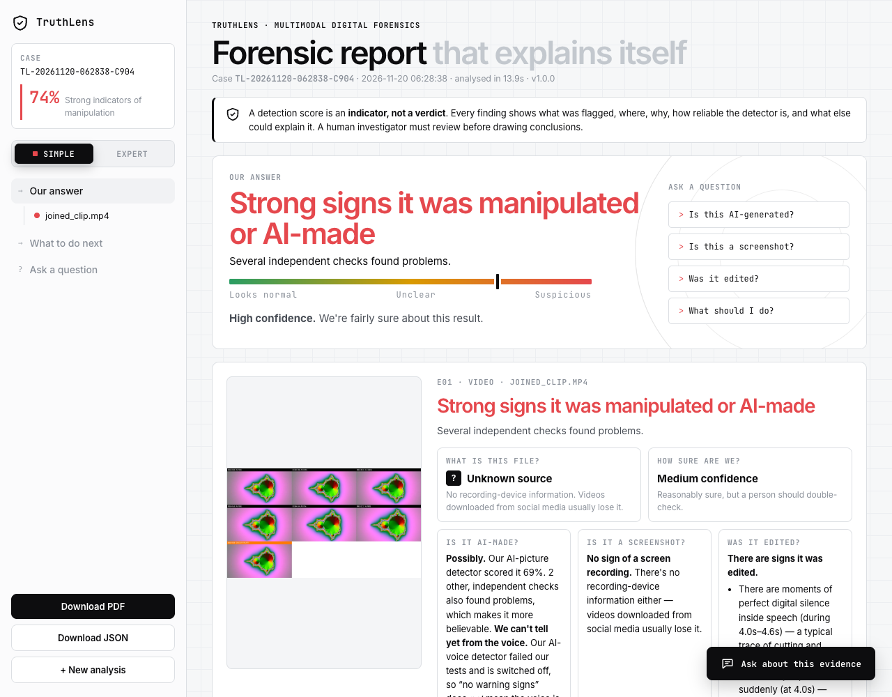
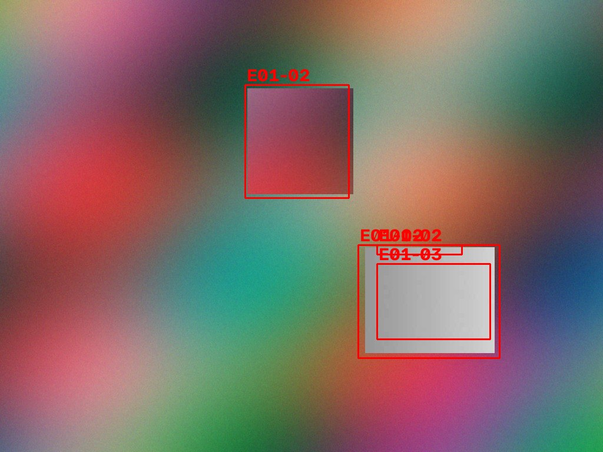
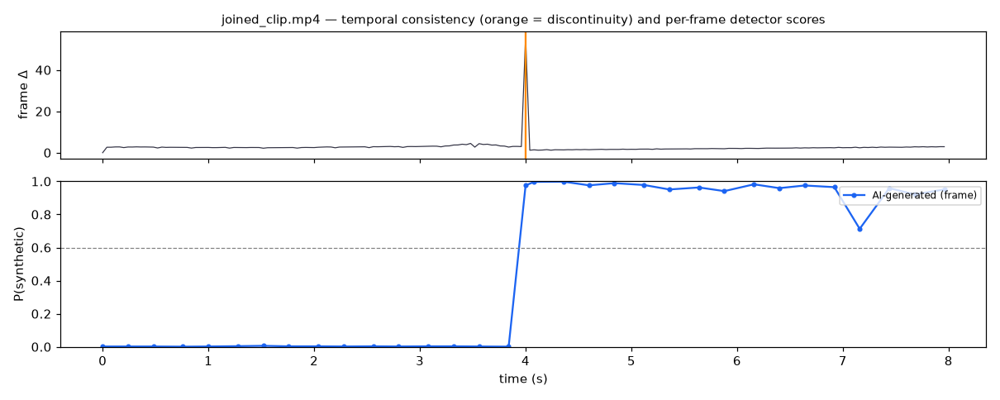

# TruthLens — Multimodal Digital Forensics & Deepfake Detection

[](https://github.com/Yashas95/yuvaHacks/actions/workflows/tests.yml)
[](https://github.com/Yashas95/yuvaHacks/actions/workflows/image.yml)

**InnovEdge Hackathon 2026 · Problem Statement 04 · Team YUVA (team no. 5) · Team leader: Yashas S**

TruthLens takes image, video, audio and text evidence and
produces an **explainable forensic report**: what was flagged, where (region / frame / timestamp / audio segment),
why, how reliable each detector is, what else could explain it, how signals across media relate, and the
limitations of the result. It runs fully offline on a laptop, so evidence never has to leave the machine.

> A detection score is an indicator, not a verdict. TruthLens is built to say *"we can't tell"* rather than
> produce a confident wrong answer — see [docs/METHODOLOGY.md](docs/METHODOLOGY.md) for how we measured that.



## For judges: a 3-minute tour

| What to check | Where to see it |
|---|---|
| **It works** | Live demo: **<https://truthlens-xrw9944xr57c6xr7-7860.app.github.dev>**. Click a planted sample (spliced photo, joined video, edited voice note) or upload your own file. It runs on a free GitHub Codespace, so it is online while our team keeps it running; the [Quick start](#quick-start) runs the same app locally. |
| **It explains itself** | Every report answers four plain questions per file (*What is this file? Is it AI-made? Is it a screenshot? Was it edited?*). The Expert view lists every finding with what was measured, why it matters, how reliable the detector is, and what else could explain it. |
| **It is honest about uncertainty** | Findings that rest only on ML classifiers are capped at "Inconclusive", and models that failed our own tests are shown but not counted. The dated evidence for each rule is in [docs/METHODOLOGY.md](docs/METHODOLOGY.md). |
| **It is tested** | 12 regression tests, each pinning a fix for a real failure ([`tests/test_core.py`](tests/test_core.py), run on every push by [CI](.github/workflows/tests.yml)), plus a golden check that every verdict and finding stays the same after a change ([`tools/regress.py`](tools/regress.py)). |
| **It is our own work** | Which pretrained models we reuse, under which licenses, and everything we wrote ourselves: [docs/ORIGINALITY.md](docs/ORIGINALITY.md). |
| **It goes where fakes spread** | A Chrome extension checks an Instagram post or reel where you see it: [extension/](extension/README.md). |

---

## What the problem statement asks for → where TruthLens does it

| Required in the report | Implementation | Code |
|---|---|---|
| Flagged evidence (region, frame, timestamp, audio segment) | Boxes on images, flagged-frame strips, a clickable flag timeline, shaded spectrogram segments | `image_forensics.py`, `video_forensics.py`, `audio_forensics.py`, `report.py` |
| Indicator + why it was flagged | Every indicator has *observation*, *why*, *signal strength*, *detector reliability*, *alternative explanations* | `evidence.Indicator` |
| Cross-modal context | Caption ↔ image (CLIP), caption ↔ speech (Whisper), claim date ↔ file date, video cut ↔ audio splice at the same time, same scene across files | `correlate.py` |
| Calibrated confidence + limitations | Likelihood, plausible range, confidence level; ML-only findings capped; limitations listed per case | `scoring.py`, `pipeline.py` |
| Source trace | SHA-256 at intake, read-only evidence copies, re-hash after analysis, analysis log | `evidence.Case` |
| Summary + recommended human checks | Key findings, plain-English answers per file, checklist of human checks (reverse search, SynthID, original file…) | `plain.py`, `scoring.recommended_checks` |

Two views of every report: **Simple** (plain-English answer per file: *What is this file? Is it AI-made? Is it a
screenshot? Was it edited?*) and **Expert** (every measurement). An offline **case assistant** answers questions
like *"is this AI generated or a screenshot?"* using only the case's own measurements — no LLM, no internet.

| Planted splice: boxed where it was pasted and cloned | Planted joined video: the cut found at exactly 4.0 s |
|---|---|
|  |  |

Both come from `test_assets/`: synthetic files with manipulations we planted ourselves, so the right answer is known.

### Browser extension: check a post where you see it

[`extension/`](extension/README.md) is a Chrome extension. Right-click a photo, post or reel on Instagram (or any
site) and choose **Check with TruthLens**. The verdict appears in a panel on the same page, with a link to the full
report. If the site gives a normal file URL, the extension sends the original file. For streamed reels it sends
a screen capture of the frame, and the panel says that the metadata and audio checks could not run.

## Quick start

```bash
./setup.sh                                   # venv, dependencies, face-detector weights, all models (one time)
.venv/bin/python app.py                      # web app → http://localhost:8000
.venv/bin/python cli.py photo.jpg clip.mp4 --context "claimed caption"   # command line, prints verdict + report path
HF_HUB_OFFLINE=1 .venv/bin/python app.py     # force offline (venue without Wi-Fi)
.venv/bin/python tests/test_core.py          # scoring / rule regression tests (no models needed)
.venv/bin/python tools/regress.py check      # golden check: every verdict and finding unchanged after a refactor
```

### Hosted demo (GitHub Codespaces, free hours)

Our running instance: <https://truthlens-xrw9944xr57c6xr7-7860.app.github.dev>. To start your own, on GitHub click **Code → Codespaces → Create codespace on main**. `.devcontainer/` pulls the image that `.github/workflows/image.yml` builds from the
`Dockerfile` (published to `ghcr.io/yashas95/truthlens`) and starts TruthLens in hosted mode on port 7860. In the **Ports** tab, set port 7860 to
**Public** to share the link. The first build takes ~10–15 min; later starts take a minute or two.

### Alternative: Hugging Face Space

```bash
.venv/bin/hf auth login                                        # once, with your own write token
.venv/bin/python tools/deploy_hf_space.py <hf-username>        # create/update the Space; it rebuilds itself
TRUTHLENS_PASSWORD=... .venv/bin/python tools/deploy_hf_space.py <hf-username>   # optional access password
```

The `Dockerfile` pins the tested package versions (CPU PyTorch) and bakes the models into the image.
Hosted mode (`TRUTHLENS_HOSTED=1`) changes the privacy wording, shows each visitor only their own cases, and uses
unguessable case IDs. Expect slower analysis than on Apple Silicon, and cases are wiped when the Space restarts.

Requires Python 3.12+ and `ffmpeg`/`ffprobe`. Developed on a MacBook Air M4 (16 GB); uses Apple MPS when available.
Each analysis writes `cases/TL-<time>-<id>/` with read-only evidence copies, artifacts, `report.json` and a
self-contained `report.html` (print → PDF).

## Pipeline

```
 upload ──► INGEST ──► ANALYZE (per file) ──► CORRELATE ──► SCORE ──► VERIFY ──► REPORT
            SHA-256     image / video /         across media    detector    re-hash     HTML (Simple +
            read-only   audio / text           and the claim   families    evidence    Expert) + JSON
            copy                                                                       + offline assistant
```

### Detectors (all in `truthlens/`)

| Family | Checks | Evidence type |
|---|---|---|
| **Provenance** | EXIF/XMP/PNG chunks, C2PA Content Credentials decoded (IPTC “trainedAlgorithmicMedia” = AI) in images, video and audio, AI-generator signatures, editing software, capture vs modified dates, video container tags, visible corner watermark/logo, TTS-native audio sample rate | direct, non-ML |
| **Pixel** | Error Level Analysis (texture-normalized, localized), sensor-noise inconsistency, SIFT copy-move, FFT periodic artifacts | signal processing |
| **Temporal** | Full-frame scan for cuts/splices (ignoring recorder start/stop), duplicated or frozen frames, A/V length mismatch | signal processing |
| **Audio signal** | Digital-silence gaps inside speech, background noise-floor jumps (splices), band-limited spectrum | signal processing |
| **ML classifiers** | AI-image classifier on images and sampled frames, face deepfake classifier on detected faces (YuNet; scores shown, not counted), synthetic-voice classifier (not run) | learned, *weakest* |
| **Context** | Claim extraction (dates, entities, numbers), persuasion language, CLIP caption ↔ visual, Whisper caption ↔ speech (only for claims about speech) | cross-modal |
| **Corroboration** | A video cut that coincides with a localized audio edit; same scene across files | cross-modal |

### Scoring (`truthlens/scoring.py`)

- Each indicator contributes `signal × reliability`. Reliabilities are expert-set and listed in `config.RELIABILITY`.
- **Within a family** the strongest indicator dominates — correlated detectors don't stack.
  **Across families** contributions combine as independent lines of evidence (noisy-OR).
- **ML-only cap:** unless a non-ML family reaches 0.25, the likelihood is capped at 44 % (Inconclusive) with
  Low confidence. "Strong" always needs independent forensic, provenance or temporal evidence.
- "Looks authentic" from an AI-generation classifier only weakens ML evidence; it never cancels splice/edit evidence.
- Models are only trusted after local evaluation: `VALIDATED_MODELS` (can lift ML-only findings to Moderate) and
  `UNRELIABLE_AUDIO_MODELS` (not run; the report says why) in `config.py` record the measured reason.

## How we found what works (summary)

Full dated record with every number: **[docs/METHODOLOGY.md](docs/METHODOLOGY.md)**.

1. **A real selfie video scored 94 % "Strong".** Three ML classifiers reacting to the same compression were counted
   as independent. → detector families + ML-only cap. Now 40–44 % Inconclusive.
2. **A Veo 3 video was missed.** The SDXL-era image classifier output 1.000 on *every* frame of both the real and the
   AI video (AUC 0.25). We built `tools/eval_detectors.py`, tested replacements, and switched to the best one — then a
   second real video (FaceTime capture, 0.998) dropped it to AUC 0.62, so we withdrew its "validated" status.
3. **A real FaceTime capture scored 88 %.** Root causes were rule bugs, not evidence: corroboration matched cuts
   against a whole-clip classifier segment, the first frame counted as a cut, and one weak cut unlocked the ML score.
   All three fixed → 44 % Inconclusive.
4. **A planted splice was hidden by "not AI-generated".** Authenticity signals are now scoped to the family they
   speak about.
5. **The synthetic-voice model was wrong on 4/4 files** (AI voices 0 %, real voices 100 %). Switched off, reported
   as such, and replaced by a non-ML lead (22.05/24 kHz TTS-native sample rate).
6. **A Gemini-generated song scored 40 %.** Its MP3 carried a Google-signed Content Credentials (C2PA) manifest saying
   “Created by Google Generative AI” that the audio path never read. `provenance.py` now decodes these manifests in
   images, video and audio → 92 % Strong.
7. **The face-deepfake model scored a real selfie like the AI videos** (0.81 vs 0.80 / 0.88). It now stays visible
   but isn't counted, like the voice model. The real selfie went 40 % → 20 %; the AI videos stay at 44 %.

Every rule above is pinned by a test in [`tests/test_core.py`](tests/test_core.py).

## Current results (2026-11-20)

| File | Truth | TruthLens |
|---|---|---|
| WhatsApp selfie video | real | 20 % Inconclusive |
| FaceTime screen capture | real | 44 % Inconclusive (19 Nov; file no longer available to re-run) |
| Veo 3 video via Instagram | AI | 44 % Inconclusive |
| Wan avatar video | AI | 44 % Inconclusive |
| AI try-on image | AI | **95 % Strong** (Google Content Credentials: generative AI) |
| Gemini-generated song | AI | **92 % Strong** (Google Content Credentials + SynthID declared) |
| AI voice reel (24 kHz) | AI | 48 % Moderate |
| macOS text-to-speech | AI | 9 % — missed |
| Planted spliced photo | edited | 45 % Moderate (regions boxed at the paste) |
| Planted joined video | edited | **74 % Strong** (cut at 4.0 s + audio anomaly) |
| Planted voice note | edited | 32 % Inconclusive (silence gap, noise jump, band limit found) |
| iPhone screenshot | unknown | 5 %, identified as a screenshot |

**Honest reading:** forensic evidence (provenance, splices, cuts, planted regions) is found and localized.
Separating AI-generated video/voice from heavily processed real media with ML alone is **not yet reliable** on our
data — TruthLens reports those as Inconclusive with the reason, and never as a confident false positive.
Small sample: treat as anecdotes; the evaluation tooling is in place to grow it.

## Models

| Role | Model | Status |
|---|---|---|
| AI-image (images + frames) | `haywoodsloan/ai-image-detector-deploy` (fallback `Organika/sdxl-detector`) | used, not validated (AUC 0.62 on 2 real / 4 AI) |
| Face deepfake | `prithivMLmods/Deep-Fake-Detector-v2-Model` | **scores shown, not counted**: real selfie 0.81 vs AI videos 0.80 / 0.88 |
| Synthetic voice | `MelodyMachine/Deepfake-audio-detection-V2` | **not run**: failed local evaluation |
| Caption ↔ image | `openai/clip-vit-base-patch32` | used |
| Speech-to-text | `openai/whisper-base` | used |
| Face detection | OpenCV YuNet (`weights/`) | used |

## Repository layout

```
app.py                  FastAPI web app: upload, sample analysis, progress polling, case list, report serving
cli.py                  command-line analysis
download_models.py      pre-download every model for offline use
setup.sh                one-time setup
Dockerfile              container image (CPU PyTorch, pinned versions, models baked in), built by CI
.devcontainer/          Codespaces: pull that image and start TruthLens on port 7860
.github/workflows/      tests.yml (rule tests + extension checks on every push), image.yml (image → GHCR)
truthlens/
  pipeline.py           orchestrates ingest → analyze → correlate → score → verify → report
  evidence.py           Case (hashing, read-only copies, integrity re-check, analysis log) and Indicator
  acquisition.py        how the extension obtained a file (original, recording, frame, copy, screenshot), which checks apply
  image_forensics.py    metadata, ELA, sensor noise, copy-move, FFT, AI-image + face classifiers
  video_forensics.py    container tags, temporal cuts/duplicates, watermark overlay, per-frame ML, audio track
  audio_forensics.py    silence gaps, noise-floor splices, band limit, sample-rate lead, voice classifier, Whisper
  text_forensics.py     claim extraction and persuasion language
  provenance.py         C2PA Content Credentials reader (AI source type, actions, signer) for all media
  correlate.py          cross-modal checks (CLIP, transcript, dates, cut↔audio, same scene)
  scoring.py            detector families, ML-only cap, confidence, recommended checks
  plain.py              plain-English answers (origin, AI?, screenshot?, edited?) for the Simple view and assistant
  report.py             self-contained HTML report (Simple + Expert views)
  models.py             lazy, fault-tolerant Hugging Face model loading
  media_io.py           ffmpeg / ffprobe helpers (container info, audio decoding)
  config.py             model candidates, detector reliabilities, validated / unreliable model lists
  assets/               report.css, report.js, chat.js (offline case assistant) — inlined into each report
  hand_field.json       halftone hand animation data for the landing page
web/index.html          landing / upload page
tools/
  eval_detectors.py     measure which models separate real from AI files (AUC, FPR, TPR, saturation)
  regress.py            golden check: record every verdict and finding, prove later changes didn't alter them
  make_test_assets.py   generate planted manipulations (spliced photo, joined video, edited voice note)
  make_hand_field.py    build hand_field.json from the public-domain "Creation of Adam" image
  run_demo_batch.sh     run every file in demo_samples/ (or test_assets/) and print verdicts
  deploy_hf_space.py    create / update the Hugging Face Space
  test_audio_models.py  compare voice-deepfake models on known samples
extension/              Chrome extension: check a post / reel in place (right-click or pick mode)
tests/test_core.py      regression tests for the scoring, plain-language and capture rules (no models needed)
tests/golden.json       golden results for the synthetic test_assets/ (used by tools/regress.py)
test_assets/            planted test media (synthetic, safe to share)
docs/METHODOLOGY.md     dated evidence for every detection decision
docs/ORIGINALITY.md     models + licenses, techniques we implemented, what we built
docs/img/               screenshots used in this README
```

## Evidence handling and privacy

Uploaded files are copied read-only into the case folder, hashed (SHA-256) at intake and re-hashed after analysis;
every step is logged. Nothing is uploaded anywhere. `cases/` and `demo_samples/` (real people's media) are
git-ignored and never published.

## Originality and third-party models

TruthLens reuses pretrained classifiers, and reuses them unmodified under their licenses. It treats them as its
*weakest* evidence. The scoring, cross-modal correlation, forensic implementations, evaluation harness, reports and
extension are our own work. The full list of each model, its author and license, the published techniques we
implemented, and what we built is in [docs/ORIGINALITY.md](docs/ORIGINALITY.md).

## Team

**Team YUVA** (team no. 5) · InnovEdge Hackathon 2026 · Team leader: **Yashas S**

## License

Our code is released under the [MIT License](LICENSE). The pretrained models keep their own licenses, listed in
[docs/ORIGINALITY.md](docs/ORIGINALITY.md).

## Credits

Landing-page hand motif derived from Michelangelo, *The Creation of Adam* (public domain), via Wikimedia Commons.
